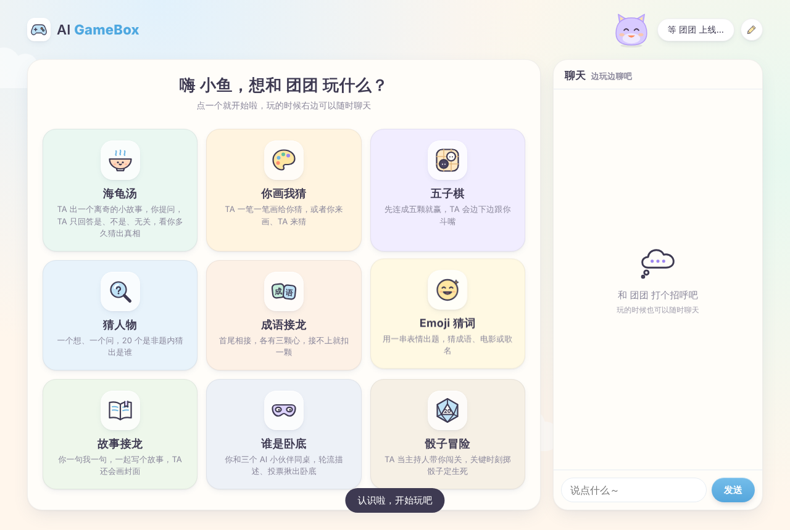
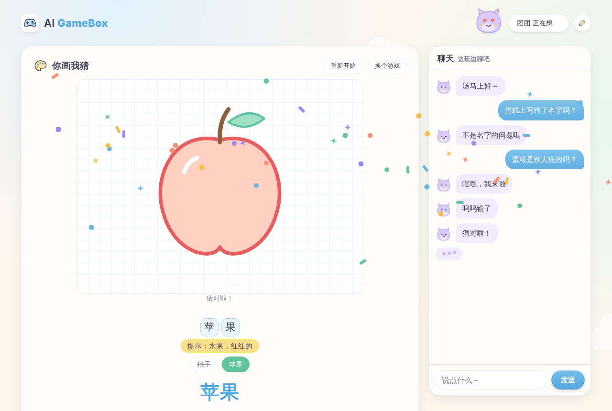
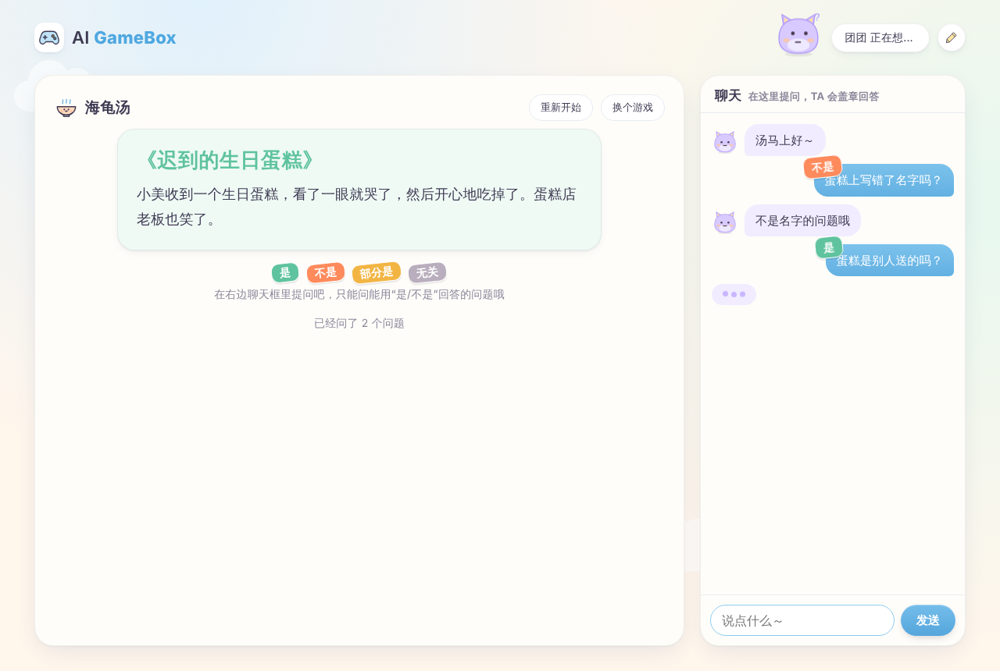
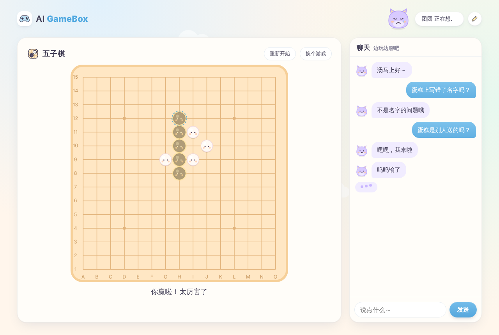
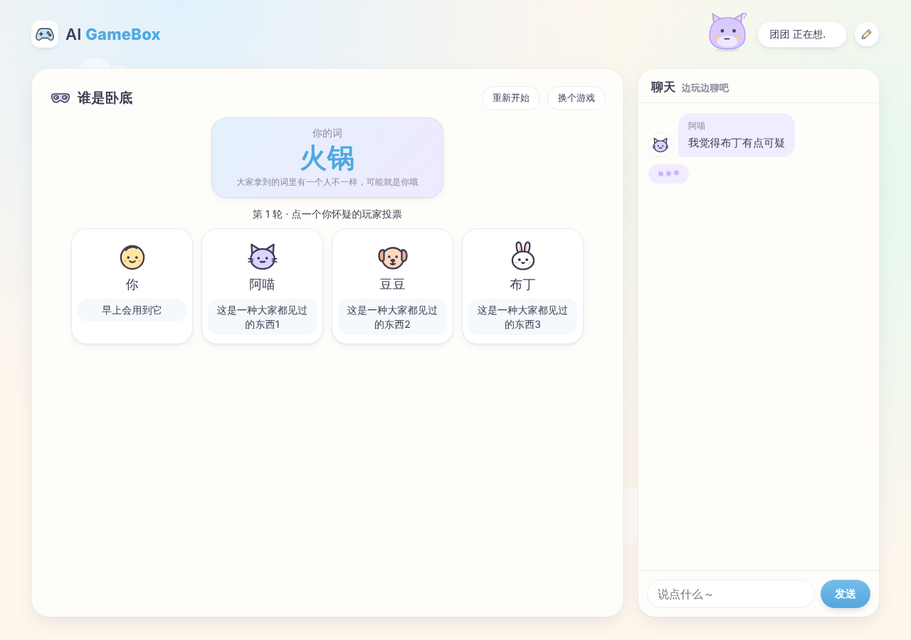

# AI GameBox

一个让 AI agent 陪你玩小游戏的 Skill。agent 会在你电脑上打开一个可爱的小网页，你们在网页里玩，边玩边聊。

版本 1.0 · **免费使用**，个人和商用都可以，也可以随意修改和分享（MIT 许可证，见 `LICENSE`）。



| 你画我猜 | 海龟汤 |
|---|---|
|  |  |
| **五子棋** | **谁是卧底** |
|  |  |

目前有九个游戏：

- **海龟汤**：agent 出题当主持人，你提问，它盖章回答“是 / 不是 / 无关 / 部分是”
- **你画我猜**：agent 一笔一笔画给你猜；或者你来画，agent 看图猜
- **五子棋**：圆滚滚的小团子棋子，agent 边下边斗嘴
- **猜人物**：一个想、一个问，20 个是非题内猜出是谁，双方都能当出题人
- **成语接龙**：首尾相接，各有三颗心，agent 会帮你检查是不是真成语
- **Emoji 猜词**：用一串表情出题猜成语、电影、歌名，累计比分
- **故事接龙**：你一句它一句写个小故事，完结时 agent 还会画一张封面
- **谁是卧底**：你和 agent 扮演的三个 AI 小伙伴（阿喵、豆豆、布丁）同桌，轮流描述、投票揪出卧底
- **骰子冒险**：agent 当跑团主持人，你选职业闯关，关键时刻在网页上掷 d20 定成败

只需要电脑上有 Python 3.8 或更新版本，不用装任何依赖，也不联网。

- macOS：一般自带，终端里输入 `python3 --version` 能看到版本号就行。没有的话装 Xcode 命令行工具（`xcode-select --install`）或去 python.org 下载。
- Windows：去 python.org 下载安装，安装时勾选 “Add Python to PATH”。
- Linux：系统自带的 `python3` 即可。

## 安装

用 git 直接装到 Claude Code（其他 agent 换成下表里的路径）：

```bash
git clone https://github.com/HalfAI1102/ai-gamebox.git ~/.claude/skills/ai-gamebox
```

或者在 GitHub 页面点 **Code → Download ZIP**，解压后把整个文件夹改名为 `ai-gamebox`，放到对应位置：

| Agent | 放在哪里 |
|---|---|
| Claude Code | `~/.claude/skills/ai-gamebox/` |
| Codex（CLI / App） | `~/.agents/skills/ai-gamebox/` |
| WorkBuddy | `~/.workbuddy/skills/ai-gamebox/`，或在应用里导入技能（待实测） |
| 豆包电脑版 | 技能 → 我的技能 → 新建 → 上传技能，把文件夹拖进去（待实测） |

Windows 上 `~` 指 `C:\Users\你的用户名`。放好后重启一下 agent，然后对它说“打开 AI GameBox”“陪我玩个游戏”或“来局五子棋”就行。

第一次打开网页时，会请你填自己的昵称、给 AI 起名字并挑一个形象（小猫、小兔、小熊、小狗、机器人）。之后随时可以点右上角的铅笔修改。

升级到新版本时，用 git 安装的在文件夹里运行 `git pull`，下载 ZIP 的直接用新文件夹覆盖旧的，并让 agent 运行一次 `game.py stop` 关掉旧的游戏桌。你的昵称和设置保存在 `~/.ai-gamebox/`，不会丢。

## 小贴士

- **权限确认**：agent 每回合都会运行 `scripts/game.py`。如果每次都弹出确认，可以把这个命令设为“总是允许”，否则游戏会一直卡在确认上。
- **网页没自动打开**：复制 agent 发给你的网址到浏览器即可。
- **agent “走神了”**：网页右上角提示走神时，回到 agent 的对话窗口说一句“继续玩”。
- **不能运行命令的环境**（比如网页版聊天）：agent 会改成在对话里直接玩文字版。
- **你画 AI 猜**需要 agent 能看图片；看不了的话 agent 会建议换成它画你猜。
- 游戏数据和你的画保存在 `~/.ai-gamebox/`，关掉游戏桌（`game.py stop`）或闲置 3 小时后服务器会自动退出。

## 文件结构

```
SKILL.md            给 agent 的说明：怎么启动、游戏循环、聊天人设
games/*.md          每个游戏的规则和玩法要点（agent 按需读取）
scripts/game.py     agent 用的命令行：start / wait / say / move / draw ...
scripts/server.py   本地服务器：保管状态、当裁判、给网页推送
assets/web/         网页（纯 HTML/CSS/JS）
docs/screenshots/   README 用的截图（运行时用不到）
```

## 自己试一下（不需要 agent）

```bash
python3 scripts/game.py start                  # 打开网页
python3 scripts/game.py wait                   # 在网页上点点，看 agent 会收到什么
python3 scripts/game.py say "你好呀" --mood love
python3 scripts/game.py stop
```

## 许可

MIT 许可证，免费使用、修改和分发，只需保留 `LICENSE` 里的版权声明。软件按“现状”提供，不附带任何担保。
